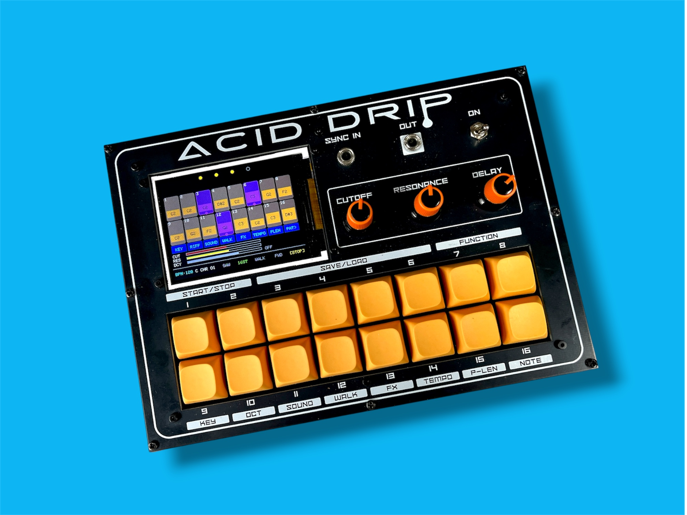
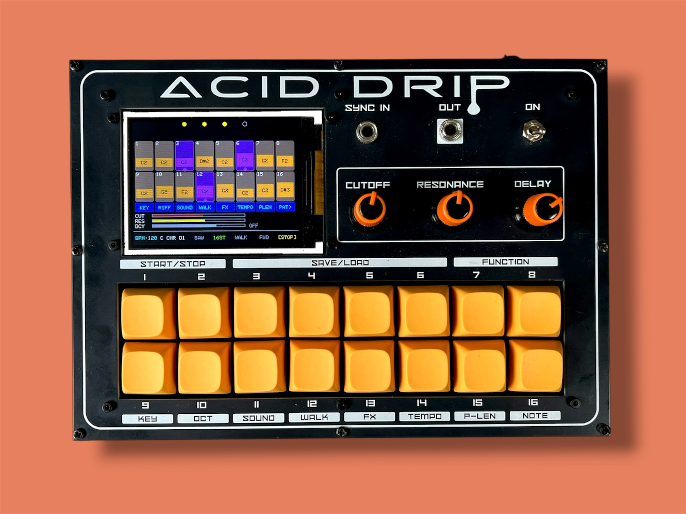
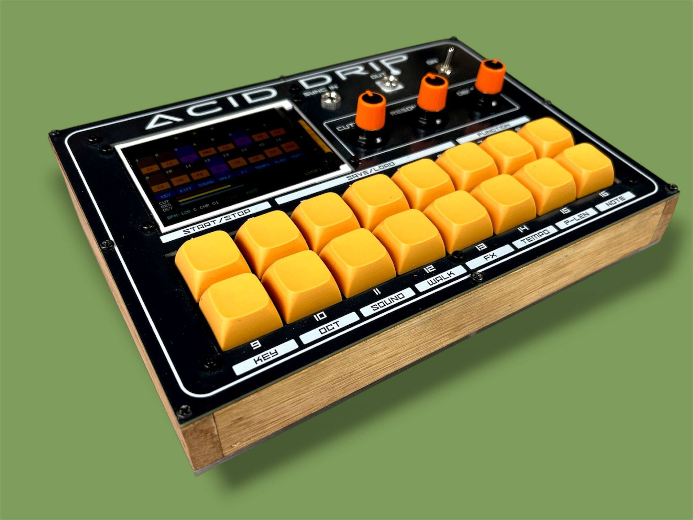

# Acid Drip: bassline synth, DRIFT synth and drum machine

Acid Drip is a DIY groovebox with three instruments: a 16-step acid bassline synth, a second synth voice (DRIFT) and a 16-pattern drum machine. It uses an RP2040 (Raspberry Pi Pico), the Mozzi audio library, a 320 × 240 colour screen and 16 Cherry MX pads.

<p align="center">
  
  &nbsp;
  
  &nbsp;
  
</p>

> **Note:** The photos show hardware version 1. The files in this repository are for hardware version 2. Version 2 has one more pot (for the mix).

## Download the firmware

<p align="center">
  <a href="https://github.com/lonesoulsurfer/Acid_Drip_Bassline_and_Drum_Synth/releases/latest"></a>
</p>

> **Warning:** Do not use **Code → Download ZIP** to get the firmware. That ZIP has the source code only. It does not have the `.uf2` file. Get the `.uf2` file from the [latest release](https://github.com/lonesoulsurfer/Acid_Drip_Bassline_and_Drum_Synth/releases/latest).

## Video

[](https://youtu.be/anotb2mvv04)

Click the image to watch the video on YouTube.

## What you need

### Hardware

| Part | Details |
|------|---------|
| Microcontroller | RP2040 (Raspberry Pi Pico or equivalent) |
| Screen | ILI9341, 320 × 240, SPI |
| Pads | 16 × Cherry MX switches (2 rows of 8) |
| Pots | CUT, RES, DECAY (and MIX on hardware version 2) |
| Audio out (acid) | GP15 → 100 Ω + 10 nF RC filter → 3.5 mm jack |
| Audio out (drums and DRIFT) | GP2 → 470 Ω → 3.5 mm jack |
| Sync in or out | GP2. A switch selects audio or sync. |

All parts are in the [parts list](Parts_List/). The PCB and front panel Gerber files are in [Gerber_Files](Gerber_Files/). The schematic is [Schematic.png](Schematic.png).

### Wiring

```
TFT   : SCK=GP6  SDA=GP7  RST=GP8  DC=GP10  CS=GP13
Pots  : CUT=GP26  RES=GP28  DCY=GP27
Sync  : IN/OUT=GP2
Audio : Acid=GP15   Drums/DRIFT=GP2

Top row pads (steps 1-8):
  GP14=pad1  GP12=pad2  GP11=pad3  GP16=pad4
  GP17=pad5  GP19=pad6  GP20=pad7  GP21=pad8

Bottom row pads (steps 9-16 / FUNC select):
  GP0=pad9   GP1=pad10  GP3=pad11  GP4=pad12
  GP5=pad13  GP9=pad14  GP18=pad15 GP22=pad16
```

### Software (only if you compile the firmware yourself)

- Arduino IDE 2
- Board package: **Raspberry Pi Pico/RP2040** by Earle Philhower
- Libraries (install them with the Library Manager):
  - **Mozzi** (version 2)
  - **Adafruit GFX Library**
  - **Adafruit ILI9341**

## Install the firmware

A `.uf2` file is the firmware, ready to use. You do not need the Arduino IDE to install it. You copy it to the Pico, as you copy a file to a USB stick.

### Step 1: Download the file

1. Go to the [latest release](https://github.com/lonesoulsurfer/Acid_Drip_Bassline_and_Drum_Synth/releases/latest).
2. In the **Assets** list, click the `.uf2` file for the version that you want. Your browser downloads it.

The release has one `.uf2` file for each firmware version. Use the newest version, unless you want an older one. V5 has all the V4 functions, and it adds DRIFT, pattern chaining, MIX EDIT and a custom drum pattern.

### Step 2: Copy the file to the Pico

Use method A if you can reach the **BOOTSEL** button on the Pico. Use method B if the Pico is inside a case.

#### Method A: with the BOOTSEL button

1. Disconnect the USB cable from Acid Drip.
2. Push and hold the **BOOTSEL** button. It is the small white button on the Pico.
3. While you hold the button, connect the USB cable to your computer.
4. Release the button. A drive with the name **RPI-RP2** opens on your computer.
5. Drag the `.uf2` file onto the **RPI-RP2** drive.
6. Wait about 5 seconds. The drive closes, the Pico restarts, and Acid Drip starts.

#### Method B: without the BOOTSEL button (Windows)

This method uses a tool from the Arduino IDE. You must install the Arduino IDE and the **Raspberry Pi Pico/RP2040** board package first. See [Software](#software-only-if-you-compile-the-firmware-yourself).

1. Connect Acid Drip to your computer with the USB cable.
2. Close the Arduino IDE.
3. Find the COM port of Acid Drip. Open **Device Manager** and look under **Ports (COM & LPT)**. An example is `COM5`.
4. Open the folder that has the `.uf2` file in File Explorer.
5. Click in the address bar. Type `powershell` and push **Enter**. A PowerShell window opens in that folder.
6. Paste these lines. Change `COM5` to your COM port, and change the file name to the name of your file.
7. Push **Enter**.

```powershell
$base = "$env:LOCALAPPDATA\Arduino15\packages\rp2040"
$py = (Get-ChildItem "$base\tools\pqt-python3" -Recurse -Filter "python3*.exe" | Select-Object -First 1).FullName
$tool = (Get-ChildItem "$base\hardware\rp2040" -Recurse -Filter uf2conv.py | Sort-Object FullName -Descending | Select-Object -First 1).FullName
& $py -I $tool --serial COM5 --family RP2040 --deploy ".\Acid_Drip_Drum_Acid_Drift_V5-v5.1.0.uf2"
```

8. Wait about 10 seconds. Acid Drip restarts with the new firmware.

This is the same method that the Arduino IDE uses when you click **Upload**.

> **Note:** Your saved patterns are at the end of the flash memory. A new `.uf2` file does not usually erase them. If your patterns are important to you, write them down before you install new firmware.

## Compile the firmware (for developers)

1. Install the software in [Software](#software-only-if-you-compile-the-firmware-yourself).
2. Open the sketch folder of the firmware version that you want, in `src/`.
3. In the **Tools** menu, set these values:
   - **Board:** Raspberry Pi Pico
   - **Flash Size:** 2MB (no FS)
   - **CPU Speed:** 200 MHz
   - **Optimize:** Small (-Os) (standard)
   - **USB Stack:** Pico SDK
4. Connect the Pico.
5. Click **Upload**.

## How to play

The [user manual](docs/MANUAL.md) tells you how to use the acid synth, DRIFT, the beat machine, save and load, FUNC mode, MIX EDIT and sync.

The [quick reference guide](Acid_Drip_Quick_Reference_Guide.pdf) is a one-page summary.

## Files in this repository

| Folder or file | Contents |
|----------------|----------|
| `src/` | Firmware. One sketch folder for each version. |
| `Acid_Drip_PCB_Kicad/` | KiCad files for the PCB |
| `Front Panel Design/` | KiCad, Inkscape and DXF files for the front panel |
| `Gerber_Files/` | Gerber files for the PCB and the front panel, ready to order |
| `Parts_List/` | Parts list (PDF and Excel) |
| `docs/MANUAL.md` | User manual |
| `CHANGELOG.md` | Changes in each firmware version |

## Credits

- The acid synth engine is adapted from [Badass Bass](https://github.com/Tschibo00/BadAssbasSSynth) by Tschibo00 ([video](https://www.youtube.com/watch?v=MvDILHYImc4)).
- The drum engine is adapted from [DrumKid](https://github.com/mattybrad/drumkid) by Matt Bradshaw ([video](https://www.youtube.com/watch?v=509iZGjnVhM)).
- Acid Drip uses the [Mozzi](https://sensorium.github.io/Mozzi/) audio library.
- Hardware design and firmware: Marcus ([lonesoulsurfer](https://github.com/lonesoulsurfer)).

## Support

Do you like this project? You can support my work on [GitHub Sponsors](https://github.com/sponsors/lonesoulsurfer).

## Licence

- **Firmware** (the `src/` folder): [GNU General Public License v3.0](LICENSE). The acid engine comes from Badass Bass, which uses GPL-3.0. Thus the firmware must also use GPL-3.0.
- **Hardware** (PCB, front panel, Gerber files and schematic): [CERN Open Hardware Licence v2, Strongly Reciprocal](LICENSE-HARDWARE).
- [LICENSING.md](LICENSING.md) gives the details and the licences of the code that Acid Drip uses.
